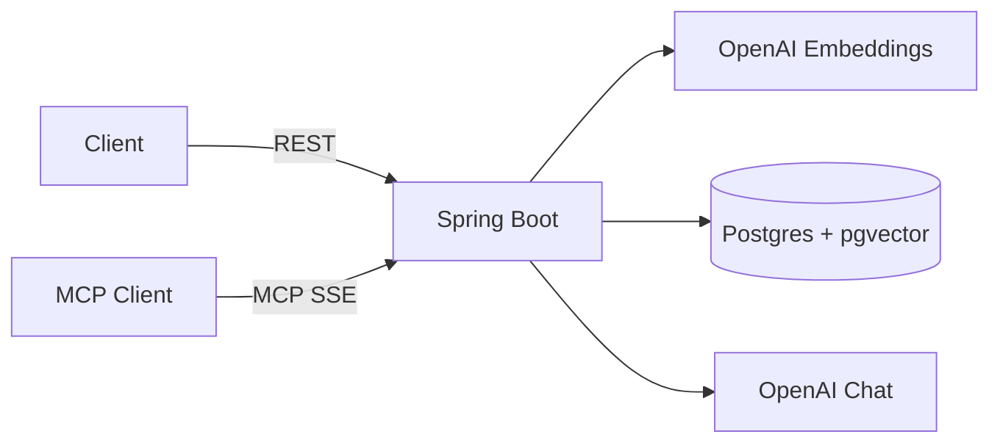

# Resume & JD Matcher AI Agent

    

> Explainable, RAG-powered candidate ranking built with Spring Boot 3, Spring AI, OpenAI and PostgreSQL/pgvector. Also exposed as an **MCP server** so AI agents can use it as a tool.

> Demo video: _TODO_ · Live demo: _TODO_

## Overview
Upload PDF resumes and a job description. The service parses and embeds the resumes, retrieves the most relevant evidence for the JD, and asks an LLM to score each candidate with structured strengths, gaps and a rationale. All sample data is synthetic.

Spring AI 1.1.8 is the current line that supports Spring Boot 3.5. The default chat model is `gpt-4o-mini` and the default embedding model is `text-embedding-3-small` (1536 dimensions). Both are overridden with `OPENAI_CHAT_MODEL` and `OPENAI_EMBEDDING_MODEL`.

## Features
- PDF resume ingestion (parse, chunk, embed) with Apache PDFBox via Spring AI's `PagePdfDocumentReader` and `TokenTextSplitter`
- Vector search with pgvector, then LLM re-ranking with structured strengths, gaps and a rationale
- Final score = `0.3 * (similarity * 100) + 0.7 * llmScore`, clamped to 0-100. Similarity is the max chunk score for that resume. Weights are `matcher.similarity-weight` and `matcher.llm-weight`.
- MCP server tools over SSE for Claude Desktop, Cursor and other MCP clients
- One-command local run with docker-compose
- A small static page at `/` for upload and results
- Deployable to AWS App Runner or ECS Fargate + RDS. See [docs/aws-deployment.md](docs/aws-deployment.md).

## Architecture


## Tech Stack
Java 21 · Spring Boot 3.5.15 · Spring AI 1.1.8 · OpenAI · PostgreSQL 16 + pgvector · Flyway · Testcontainers · Docker · AWS

## Quickstart
```bash
git clone https://github.com/guptagautam768/resume-jd-matcher.git
cd resume-jd-matcher
cp .env.example .env
# put a real key in .env — the file is gitignored
export OPENAI_API_KEY=sk-...
docker compose up --build
# API and page at http://localhost:8080
```

The API reads `OPENAI_API_KEY` from the environment. Do not commit a real key.

To click through the flow without calling OpenAI, use the `demo` profile. It uses a local hash embedding and a skill-overlap stand-in instead of a model. That ranking is only a wiring check. Use a separate Compose project so its 64-dimension vectors do not share a volume with the 1536-dimension OpenAI database:

```bash
docker compose -f docker-compose.yml -f docker-compose.demo.yml -p matcher-demo up --build
```

## API
| Method | Path | Description |
|---|---|---|
| POST | `/api/resumes` | Upload PDF resumes (multipart field `files`, PDF only, 5 MB each, up to 10 files) |
| GET | `/api/resumes` | List resumes, including parsed text |
| GET | `/api/resumes/{id}` | Get one resume |
| DELETE | `/api/resumes/{id}` | Delete a resume, its match rows, and its vectors |
| POST | `/api/jobs` | Create a job description (`title`, `description`) |
| GET | `/api/jobs` | List job descriptions |
| GET | `/api/jobs/{id}` | Get a job description |
| POST | `/api/jobs/{id}/match?topK=5` | Rank candidates and store explanations |
| GET | `/api/jobs/{id}/matches` | Get the stored ranking |
| GET | `/api/jobs/{id}/matches/{resumeId}` | Get one stored explanation, or compute it if missing |
| GET | `/actuator/health` | Health check |

```bash
curl -F "files=@samples/resumes/01-priya-natarajan.pdf" \
     -F "files=@samples/resumes/02-diego-alvarez.pdf" \
     http://localhost:8080/api/resumes

curl -H "Content-Type: application/json" \
     -d @samples/jobs/senior-backend-engineer.json \
     http://localhost:8080/api/jobs

curl -X POST "http://localhost:8080/api/jobs/<id>/match?topK=3"
```

Uploads must be PDFs (`%PDF-` header and a `.pdf` name). There is no authentication. Do not put this service on the public internet with real resumes.

## MCP Usage
The app exposes MCP tools over SSE at `http://localhost:8080/sse`. The message endpoint is `/mcp/message`.

Tools: `create_job`, `upload_resume_text`, `list_resumes`, `match_candidates`, `explain_match`.

`upload_resume_text` takes `candidateName` and `resumeText` because MCP clients in this setup send text rather than multipart files. `match_candidates` takes `jobId` and `topK` (`0` uses the default of 5). `explain_match` takes `jobId` and `resumeId`.

Example client config (point the client at the SSE URL; the exact JSON key differs by client):
```json
{ "mcpServers": { "resume-matcher": { "url": "http://localhost:8080/sse" } } }
```

This server uses the Spring AI 1.1 WebMVC SSE transport (`spring.ai.mcp.server.protocol=SSE`). It has not been exercised from Claude Desktop in this repository yet.

## Tests
Unit tests cover score blending, chunk grouping, PDF checks, prompt parsing, and the demo stand-in model. `MatcherApiTest` starts PostgreSQL 16 with pgvector via Testcontainers and runs upload, rank, fetch, and delete against the real schema. The `test` profile does not call OpenAI.

```bash
./mvnw test
```

Docker must be running so Testcontainers can start `pgvector/pgvector:pg16`.

## Deployment (AWS)
Build a container, push it to ECR, and run it on App Runner or ECS Fargate in front of RDS PostgreSQL with the `vector` extension. Put `OPENAI_API_KEY` and the database password in Secrets Manager. The health check path is `/actuator/health`. Step-by-step commands are in [docs/aws-deployment.md](docs/aws-deployment.md). Nothing in this repo is deployed yet.

GitHub Actions (`.github/workflows/ci.yml`) builds and tests on pull requests and also builds the container image. `.github/workflows/ecr.yml` is manual and pushes to ECR only after AWS OIDC is configured.

## Results
_TODO: add screenshots and evaluation once measured. No numbers have been claimed yet._

## Roadmap
- [ ] Hybrid (keyword + vector) search
- [ ] PII redaction before LLM calls
- [x] Minimal web UI
- [ ] Labeled evaluation set and metrics
- [ ] Multi-tenant auth

## License
MIT
